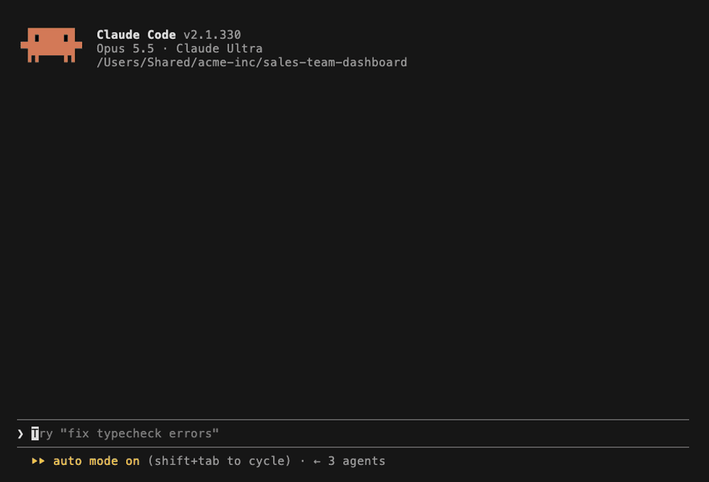

# intent-interview

[English](README.md) · 한국어

에이전트가 무언가를 만들기 전에, 내가 진짜 원하는 것을 객관식 한 문항씩 찾아내는 에이전트 스킬입니다.



<sub>이 플러그인을 켠 Claude Code에서 녹화했습니다. 기다리는 시간은 자르고 생각하는 구간은 빠르게 돌렸습니다. 답은 예시 시나리오를 따랐습니다.</sub>

- **한 번에 한 문항만 묻습니다.** 답이 나머지를 가장 많이 바꾸는 문항부터 묻습니다.
- **선택지는 기능 이름이 아니라 장면입니다.** 기획서를 쓰는 대신 그림 하나를 고르면 됩니다.
- **원하는 것을 묻는 문항에는 추천 답이 없습니다.** 추천은 답을 끌어당겨 진짜 의도를 가립니다.
- **스스로 멈춥니다.** 다음 세 문항의 답을 맞힐 수 있게 되면, 결과를 내 말 그대로 되읽고 확인받습니다.

## 이렇게 묻습니다

> "영업팀 대시보드"를 요청하셨습니다. 어느 아침에 가까운가요?
>
> 1. 팀장이 오전 9시에 열어서 팔로업이 밀린 사람을 봅니다.
> 2. 영업 담당자가 각자 열어서 자기 다음 통화 다섯 건을 봅니다.
> 3. 경영진이 금요일에 열어서 분기 흐름을 봅니다.

추천 표시는 없습니다. 1 대신 2를 고르면 쓰는 사람, 필요한 데이터, "끝났다"의 기준이 모두 달라집니다.

## 설치

Claude Code:

```
/plugin marketplace add robfold/intent-interview
/plugin install intent-interview@intent-interview
```

다른 에이전트는 [skills CLI](https://skills.sh)로 설치합니다.

```
npx skills add robfold/intent-interview
```

또는 [`skills/intent-interview/`](skills/intent-interview/) 폴더를 에이전트의 스킬 폴더에 복사합니다. Claude Code는 `~/.claude/skills/`입니다.

## 쓰는 법

에이전트에게 "만들기 전에 나부터 인터뷰해"라고 하거나 스킬 이름으로 부릅니다. 하네스에 구조화된 질문 도구가 있으면 그것을 씁니다(Claude Code는 `AskUserQuestion`). 없으면 채팅에 번호 선택지를 보입니다.

인터뷰는 결과·이유·성공 기준·넘지 않을 선·하지 않을 것, 이 다섯 줄을 되읽는 것으로 끝납니다. 이 다섯 줄을 확인받은 뒤에야 작업을 시작합니다.

## 다른 스킬이 맞을 때

이미 계획이 있고 그 빈틈을 찾고 싶다면 [Matt Pocock의 `grill-me`](https://github.com/mattpocock/skills)를 쓰세요. 한 라운드에 열린 질문 여러 개를 추천 답과 함께 냅니다. 클릭하는 객관식은 [일부러 범위 밖에 두었습니다](https://github.com/mattpocock/skills/blob/main/.out-of-scope/native-question-tool.md).

`intent-interview`는 그 앞 단계에 씁니다. 요청이 아직 흐리고, 글로 쓰기보다 고르는 쪽이 편할 때입니다.

## 출처

[addyosmani의 `interview-me`](https://github.com/addyosmani/agent-skills/tree/main/skills/interview-me), [mattpocock의 `grilling`](https://github.com/mattpocock/skills/tree/main/skills/productivity/grilling), [devbrother2024의 `deep-interview`](https://github.com/devbrother2024/skills/tree/main/deep-interview)의 아이디어 위에 만들었습니다. 문장은 새로 썼습니다. 무엇을 어디서 가져왔는지는 [SKILL.md](skills/intent-interview/SKILL.md) 끝에 있습니다.

## 라이선스

[MIT](LICENSE)
