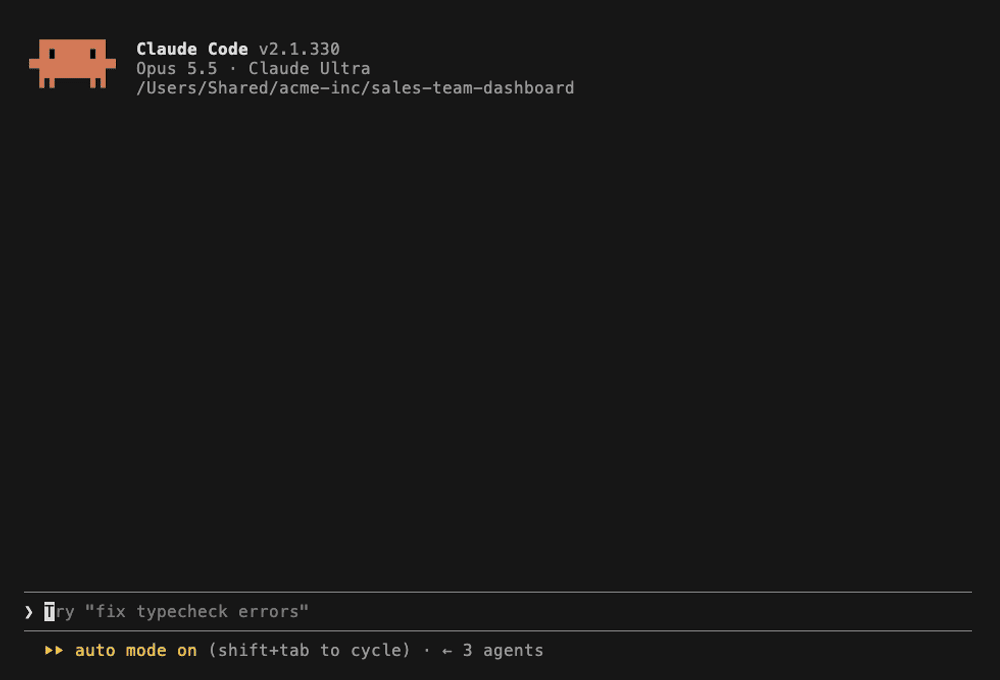

# intent-interview

English · [한국어](README.ko.md)

An agent skill that finds out what you actually want before it builds anything — one multiple-choice question at a time.



<sub>Recorded in Claude Code with this plugin loaded. Idle time is cut and thinking is sped up. The answers follow an example scenario.</sub>

- **One question per round.** It asks the question whose answer changes the most.
- **Options are scenes, not feature names.** You pick a picture instead of writing a spec.
- **No recommended answer on questions about what you want.** A recommendation pulls the answer and hides your intent.
- **It stops on its own.** Once it can predict your next three answers, it reads the result back in your words for you to confirm.

## What it looks like

> You asked for "a dashboard for the sales team". Which morning is the one you mean?
>
> 1. A manager opens it at 9 a.m. and sees who is behind on follow-ups.
> 2. Each rep opens it and sees their own next five calls.
> 3. Leadership opens it on Friday and sees the quarter's trend.

No option is marked as recommended. Picking 2 instead of 1 changes who the user is, what data the dashboard needs, and what "done" means.

## Install

Claude Code:

```
/plugin marketplace add robfold/intent-interview
/plugin install intent-interview@intent-interview
```

Other agents, with the [skills CLI](https://skills.sh):

```
npx skills add robfold/intent-interview
```

Or copy [`skills/intent-interview/`](skills/intent-interview/) into your agent's skills folder (`~/.claude/skills/` for Claude Code).

## Use

Tell your agent "interview me before you build this", or call the skill by name. It uses your harness's structured question tool when there is one (`AskUserQuestion` in Claude Code). Otherwise it shows numbered options in chat.

The interview ends with a five-line read-back — outcome, reason, success, limits, out of scope — that you confirm before any work starts. The agent then writes the result to a file, with your answers, its own assumptions, and the open items kept apart. [This INTENT.md](examples/sales-dashboard/INTENT.md) is the one the session in the GIF produced.

## When to use something else

If you already have a plan and want it stress-tested, use [Matt Pocock's `grill-me`](https://github.com/mattpocock/skills). It asks several open questions per round, each with a recommended answer, and keeps clickable multiple choice [out of scope on purpose](https://github.com/mattpocock/skills/blob/main/.out-of-scope/native-question-tool.md).

`intent-interview` is for the step before that: the request is still fuzzy, and you would rather pick than write.

## Credits

Built on ideas from [addyosmani's `interview-me`](https://github.com/addyosmani/agent-skills/tree/main/skills/interview-me), [mattpocock's `grilling`](https://github.com/mattpocock/skills/tree/main/skills/productivity/grilling), and [devbrother2024's `deep-interview`](https://github.com/devbrother2024/skills/tree/main/deep-interview). The text is new. The end of [SKILL.md](skills/intent-interview/SKILL.md) lists what came from where.

## License

[MIT](LICENSE)
